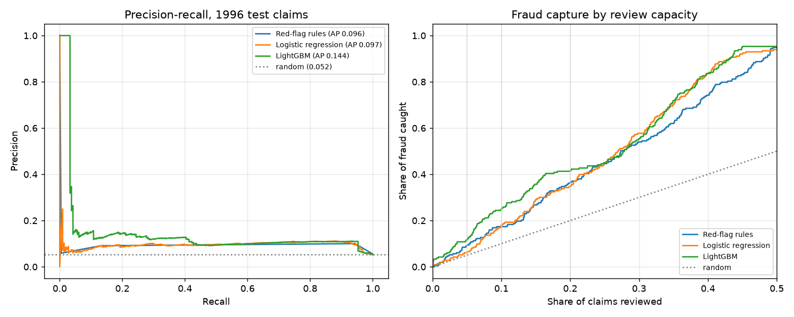
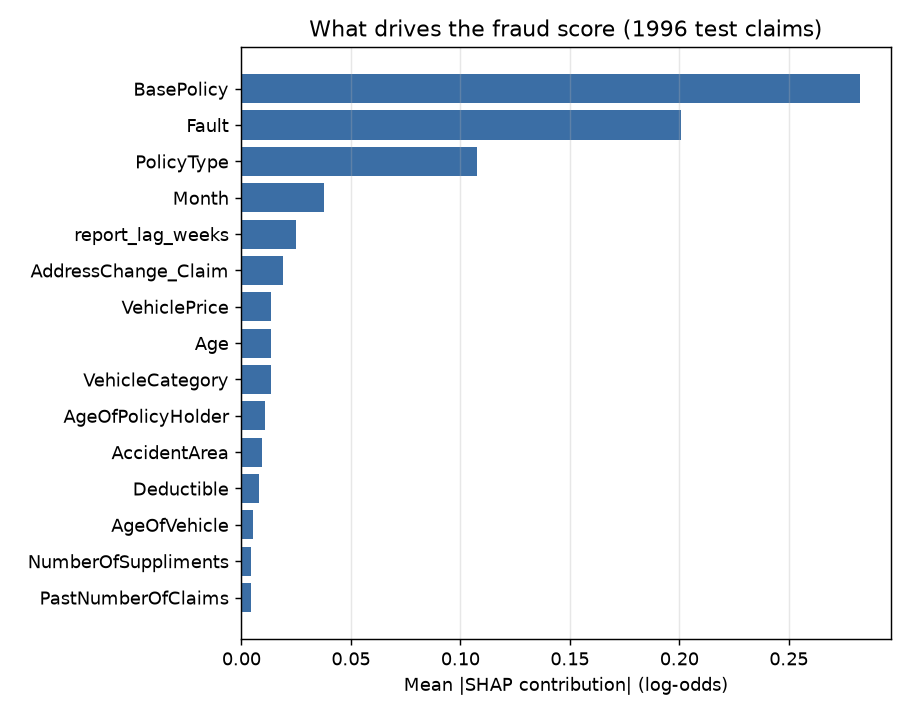

# Auto Claims Fraud Detection

Scores auto insurance claims for fraud risk and ranks them into an investigation queue, so a
special investigations unit (SIU) with limited capacity reviews the claims most likely to be fraud.
Each flagged claim comes with the reasons the model flagged it.

Data: the [Vehicle Insurance Claim Fraud Detection](https://www.kaggle.com/datasets/shivamb/vehicle-claim-fraud-detection)
dataset, with 15,419 US auto claims from 1994–1996 and 923 (6.0%) confirmed fraud.

## Results

Trained on 1994–95 claims and tested on the 4,083 claims from 1996 (213 fraud), the way the model
would be used on next year's claims:

| Model | ROC AUC | Avg. precision (95% CI) | Fraud caught reviewing 10% of claims | Precision at 10% |
|---|---|---|---|---|
| Red-flag rules (baseline) | 0.737 | 0.096 (0.084–0.110) | 16.9% | 8.8% |
| Logistic regression | 0.740 | 0.097 (0.083–0.117) | 17.8% | 9.3% |
| **LightGBM** | **0.755** | **0.144 (0.114–0.181)** | **24.9%** | **13.0%** |

With the same workload (408 claims reviewed), LightGBM catches **53 frauds versus 37** for a
red-flag checklist, which is 43% more. Its hit rate is 2.5x random. The gain is concentrated at the
top of the queue, which is where an SIU works. Logistic regression does no better than the rules,
so the lift comes from interactions between fields (policy type × fault × address change × deductible)
that a linear model or a checklist can't express.



### Random cross-validation overstates performance here

The same LightGBM model scores **0.26** average precision with random 5-fold CV on 1994–95, but
only **0.16** when folds are grouped by accident month. The 1996 test (0.14) agrees with the grouped
number. Claims from the same month look alike (fraud comes in waves), so random folds leak
information between train and test. Many published results on this dataset use random splits and
oversample before splitting, which is why they report much higher scores. Here, tuning uses
month-grouped CV and the 1996 test set is scored once.

## Triage dashboard

`streamlit run app.py` opens a dashboard that treats the 1996 claims as this year's inbox:

- **Investigation queue**: claims ranked by risk relative to the average claim, with the red-flag
  count and the model's top three reasons for each.
- **Claim detail**: the claim's fields and a SHAP chart of what raised and lowered its score.
- **Capacity and economics**: a slider for how many claims the SIU can review, plus inputs for
  investigation cost and average loss avoided. It shows fraud caught and net savings against the
  rules baseline. The dataset has no claim amounts, so the dollar figures depend on those inputs.

## Setup

```bash
python -m venv .venv
.venv\Scripts\activate
pip install -r requirements.txt
python train.py
streamlit run app.py
```

The first run downloads the data (3.6 MB). `train.py` takes about a minute. It writes `outputs/metrics.json`, `outputs/scored_claims.parquet`
(read by the dashboard) and the plots.

## Files

- `features.py`: loads the data and builds features. Bucketed fields ("2 to 4", "more than 30")
  become ordered numbers, and nominal fields stay categorical. It derives the weeks between accident
  and report, treats `Age = 0` as missing (it only appears for 16–17-year-olds), and defines the
  8-point red-flag checklist used as the baseline.
- `train.py`: time-based split, month-grouped CV tuning for logistic regression and LightGBM,
  evaluation at fixed review capacities with bootstrap CIs, and TreeSHAP reason codes for each claim.
- `app.py`: the Streamlit triage dashboard.

## What drives the score



Coverage type matters most. Liability-only policies almost never have confirmed fraud (0.7%),
because the insurer pays the other party, not the policyholder. All-perils and collision policies on
sedans and utility vehicles carry most of the risk. Other strong signals are an address change 2–3
years before the claim, a $500 deductible, a new policy (claim within 30 days of inception), and
young policyholders.

## Limitations

- **Labels are "fraud found"**, so they reflect which claims were investigated. Fraud that was never
  looked at shows up as legitimate, and the model partly learns past investigators' habits.
- **No claim amounts, dates, or claimant/provider IDs.** Real fraud models gain a lot from loss
  amounts, repair shop and attorney networks, and claim histories across policies, none of which
  are in this data.
- **Modest absolute precision.** Even the top of the queue is about 1 in 8 fraud. That's useful
  for prioritizing, but the model shouldn't be used to deny claims.
